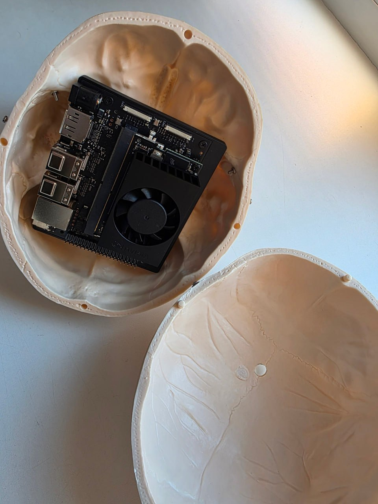
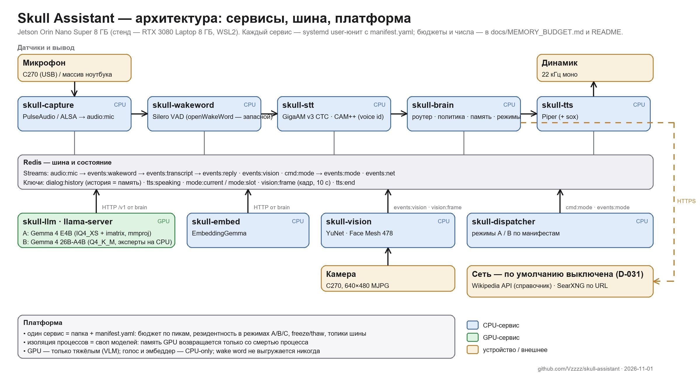

# Skull Assistant

[](https://github.com/Vzzzz/skull-assistant/actions/workflows/tests.yml) [](LICENSE)   

> **Work in progress** (early November 2026). The bench part is built and measured: the voice loop, the "think hard" mode on a 26B model through the dispatcher, the gaze trigger with a camera, arithmetic outside the model; since November 2 mode A runs on the device (Jetson Orin Nano Super 8 GB): peak memory 6.7 GB of 7.6 under 60 turns over the bus; a live voice dialogue is the next step. What works today is listed below; day-by-day state is in `docs/JOURNAL.md` (Russian).

<p align="center">
  
  <br><sub>Jetson Orin Nano inside an anatomical skull: the board with its fan takes about a third of the cranial cavity; the rest goes to the microphone, speaker, camera and power.</sub>
</p>

<p align="center">
  
  <br><sub>Services with their models, the Redis bus, the platform (labels in Russian). Numbers and descriptions are in the tables below and in <code>docs/MEMORY_BUDGET.md</code>; the diagram is generated by <code>docs/media/architecture.py</code>.</sub>
</p>

An offline voice assistant with a character — **Kostyan**, an anatomical skull that sees, hears, remembers the person it talks to and answers in its own tone — and, at the same time, a platform for running several compact ML services side by side on one edge device with 8 GB of shared memory. Nothing leaves the device.

The project is run as research: every architectural decision is backed by a measurement; the decision log (`docs/DECISION_LOG.md`) and the peak-memory budget table (`docs/MEMORY_BUDGET.md`) are part of the repository, not an appendix to an article. All numbers on one page: **[docs/RESULTS.md](docs/RESULTS.md)**. Documentation is in Russian (the target audience of the write-ups is Habr); code, identifiers and comments are in English.

## What works today (bench: RTX 3080 Laptop 8 GB, WSL2)

The full voice loop runs as a set of systemd units on a Redis Streams bus:

| Stage | What | Numbers (bench) |
|---|---|---|
| Listening | **ambient mode**: speech-onset trigger (Silero VAD), no wake word; openWakeWord kept as fallback | CPU, 41–87 MB |
| STT | **GigaAM v3 CTC** (sherpa-onnx, CPU) with punctuation and digits; Whisper `base` dropped after a bake-off (WER 25.8 % → 1.6 % on Common Voice ru) | 0.1–0.2 s per phrase, 396 MB |
| Whose voice | owner verification (CAM++, CPU, same process) with sliding windows inside a segment — answers the owner even over a podcast | EER 0.018, +57 MB, 23–66 ms |
| Brain | **Gemma 4 E4B**, own IQ4_XS + imatrix quantization, `llama-server`, 8k context, vision projector attached | 3.8 GB VRAM, 0.3–1.8 s per turn |
| Out-of-window memory | EmbeddingGemma on CPU + keyword match; exchanges that fell out of the context window come back as a note in the request | facts beyond the window: 0.07 → 0.8–1.0 |
| Turn router | turn type (chat / about the speaker / arithmetic / explain / outside world / command) in one model call, policy per type | accuracy 0.88–0.93 |
| "Should I speak now" | rubber-duck mode: addresses, muttering, phone calls, broadcast, music — conversation state + a binary model question | live: 0 replies over 3.5 h of household background, 1 false of 16 mutterings, 6/6 addresses over a podcast |
| TTS | Piper (CPU), sentence streaming, sox timbre; Qwen3-TTS 0.6B measured as a GPU candidate | first audio 0.5–1.3 s; Piper RT 0.06; Qwen3-TTS RT 0.13, 1.9 GB VRAM |
| Vision | gaze at the skull as a trigger (YuNet + Face Mesh, head turn, bands calibrated per placement); on the event one frame goes to the VLM and the line is about what is in it; the frame never enters the history | 10/12 gazes, 0 false over 20 min of work; gaze → sound 0.8–2.1 s, frame 183 tokens |
| "Think hard" mode (B) | the owner's phrase «подумай как следует» switches, through the dispatcher, to **Gemma 4 26B-A4B** (experts on CPU); the question from the same phrase goes to it with the full history; return by phrase or on idle; the switch is audible (HDD clicks) | trigger → 26B answer 17–19 s, return 7 s, 1 call per turn; A↔B switch 8–30 s, memory survives the switch |
| Arithmetic | outside the model: number/time normalization, `calc` via `ast`, the model gets a note «computed: …» | CTX-1 math 3/3 over the bus, 0 false calls |
| Network check | **the skull's network policy**: `always` / `ask` / `never`, `ask` by default — «Глянуть в сети?» ("Shall I look it up?") and the owner's yes / no; `never` — not a single request; switched without a restart; «Сейчас гляну.» + modem sound, answer from Wikipedia excerpts, an honest «not found» for news and weather | fixed a confabulation («Adelaide» → «Canberra»), 0 false trips to the network, question → answer 2–4 s |

The evaluation set **CTX-1** (60 turns with anchors for memory, arithmetic and "don't make things up") was run on 14 models from 1.7B to 9B; it picked the brain and measured what memory and the router add (`research/eval/`). The memory budget of the whole mode A — voice stack, VLM with projector, embedder, YOLO detector — was measured all at once: **6.3–6.5 GB of the 7.6 GB available on Orin** (bench-based estimate, `docs/MEMORY_BUDGET.md` §2).

Not there yet: a live voice dialogue on the Jetson (mode A is resident; sound and the first conversation are day 2), an own wake word on an MCU (sibling project), interrupting the skull while it speaks (barge-in), an object detector for the scene (full M7); fact checking via the network is done as a reference lookup (Wikipedia, D-031) — whole-web search and an agentic mode are not planned before the device. Tests on `core/` — 430+ in seconds, no models or GPU, the same run in CI. Queue: `docs/TASKS.md`; milestone plan: `docs/ROADMAP.md` §7a.

## First numbers from the device (Jetson Orin Nano Super 8 GB, November 2, 2026)

Same code and manifests as on the bench; JetPack 6.2.1, models on NVMe, eight systemd units. Full report: `research/bench/results/orin_day1_2026-11-02.md`; decisions: `docs/DECISION_LOG.md` D-032 (Russian).

| What | Bench (estimate) | Device |
|---|---|---|
| Idle system footprint | ~900 MB | **712 MB** |
| Empty CUDA context | "hundreds of MB" | **+70–82 MB** (GPU memory goes through nvmap and is invisible in process RSS) |
| Voice: capture + VAD + STT with voice id + TTS | 640–780 MB | 534 MB |
| Memory embedder (CPU) | 650 MB | 403 MB |
| VLM Gemma 4 E4B IQ4_XS + projector, 8k context | ~3.8 GB | **~4.55 GB** (nvmap 4281 + RSS 277) |
| **Whole mode A resident** | 6.3–6.5 GB | **6.15 GB idle, 6.66 GB peak** under 60 turns over the bus, 0 OOM, 945 MB headroom |
| E4B prefill / decode | ~2000 / 66–70 tok/s | **672 / 15.0** tok/s (12.8 with the voice stack running) |
| Time to first token on a 3k history | — | **4.7 s** cold, **0.1 s** with the prefix kept in the slot |
| STT GigaAM v3, RTF | — | 0.10–0.12 |
| Piper, RT | 0.06 | 0.22 |

Takeaways: the budget held, but by compensation — voice, embedder and system came in lighter than estimated while the VLM on unified memory is 0.75 GB heavier; our own IQ4_XS quantization is faster than Q4_K_M on sm_87 and 250 MB smaller; re-prefilling the history costs 5 s per 3k tokens on the device, so keeping the KV prefix in a llama-server slot is mandatory. Exceeding the budget on unified memory does not kill a process — it hangs the whole device (the OOM killer cannot see nvmap), hence admission by manifests and earlyoom preferring llama-server.

## How it is made

Two commit authors. The **human** — hardware, the bench, running every measurement, listening to voices, architectural decisions and acceptance of results. The **AI assistant** (Claude Code in three roles — researcher, executor, reviewer, see `docs/agents/`) — measurement scripts, service code against task cards, paper and repo reviews, documentation. Yes, it is vibe coding — with a journal that shows what was tried, where it broke and why this option was chosen; every number is reproducible with the scripts in `research/`.

A side result: a **PR to llama.cpp**, [#31621](https://github.com/ggml-org/llama.cpp/pull/31621). With a vision projector loaded, `llama-server` disabled KV-cache reuse for every prompt, text-only ones included; on the Orin that is 1.2 s of extra prefill on each shift of the dialog window, 0.25 s with the patch. Code and measurements with AI assistance, disclosed in the PR; the description and the discussion are the author's own, per the project's policy. Until the merge, the device runs on a fork with this patch (`deploy/build_llama.sh`, D-033).

## Layout

```
AGENTS.md     context and role protocol for agents (CLAUDE.md is the Claude Code wrapper)
services/     production: one service = folder with code + manifest.yaml (budget, residency, lifecycle)
core/         shared code: out-of-window memory, router, text and speech filters, ambient policy, A/B mode dispatcher, manifests, number normalization
tests/        pytest on core/ — no models, Redis or GPU, seconds; the same run in CI
deploy/       systemd/ — skull.target + units, install.sh; modes.yaml — per-mode budgets; stand/ — bench status, restart and mode switch from Git Bash
research/     reproducible measurements: bench/ (memory, speed), eval/ (CTX-1), memory/ (prototypes), tts/, vision/
docs/         session journal, task queue, open questions, roadmap, decision log, memory budgets, paper reviews
persona/      the character's system prompt (dataset is private, see persona/README)
models/       weights (not in git) + README with sources
```

The "production / research" boundary: `services/` holds only what a unit runs on the device. Everything that measures, compares or trains lives in `research/`. Research reaches production through a `docs/DECISION_LOG.md` entry and a manifest change.

## Architecture in brief

- Bus: Redis Streams (`audio:mic` → `events:wakeword` → `events:transcript` → `events:reply`); dialogue history in Redis, one exchange = one memory record.
- Each service is a separate systemd unit; process isolation is the model-swap mechanism (GPU memory comes back only when the process dies).
- Voice stack and embedder are CPU-only; only the VLM and the detector get the GPU. Every CUDA context costs hundreds of MB out of the same 8 GB.
- Three modes: A — 4B VLM + full sensor stack; B — a large MoE (26B-A4B) streamed from NVMe; C — "trophy". A and B work on the bench: the dispatcher (`core/dispatcher.py`) stops and starts units by their manifests, saves the llama-server KV slot across the switch, and reports the phases on `events:mode`. Invariant: the wake word / KWS is never evicted (it moves to an MCU in the sibling project `bitladder`).

Details: `docs/ROADMAP.md`; the original plan: `docs/roadmap-v1.md`.

## Running it

The repository currently describes the author's bench (WSL2 on a laptop, a maintenance flag on the Windows side — see the Russian README). A portable install guide for your own hardware is **TBD** and will come with the Jetson bring-up.

## License

MIT (`LICENSE`). Use it, keep the notice, a link back is appreciated. Model and voice weights are under their own licenses (`models/README.md`); the persona dataset is private and not part of the repository.
