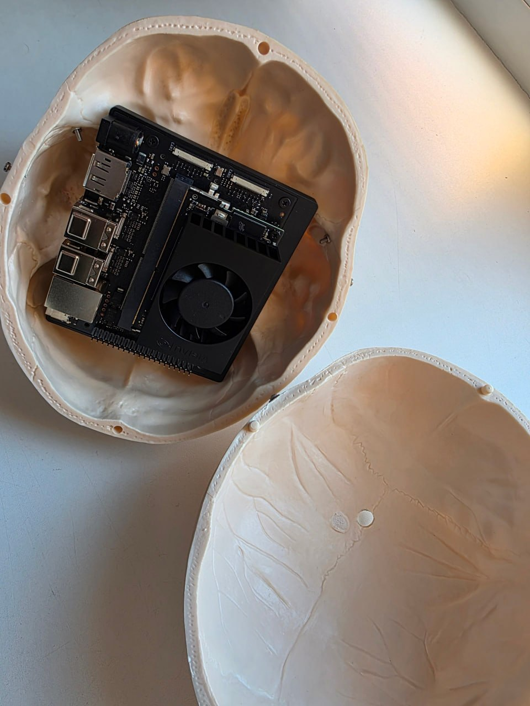

# Skull Assistant

> **Проект в работе** (октябрь 2026). Стендовая часть сделана и измерена; на устройство (Jetson Orin Nano Super 8 GB) код ещё не переносился. Что именно работает сейчас — ниже, текущее состояние по дням — `docs/JOURNAL.md`. English: [README.en.md](README.en.md).

<p align="center">
  
  <br><sub>Jetson Orin Nano внутри анатомического черепа: плата с кулером занимает примерно треть черепной коробки, остальное — микрофон, динамик, камера и питание.</sub>
</p>

Офлайн голосовой ассистент с характером — **Костян**, анатомический череп, который видит, слышит, помнит собеседника и отвечает в своём тоне, — и одновременно платформа для запуска нескольких компактных ML-сервисов на одном edge-устройстве с 8 ГБ общей памяти. Ничего не уходит в облако.

Проект ведётся как исследовательский: каждое архитектурное решение подкреплено замером, decision-log (`docs/DECISION_LOG.md`) и таблица бюджетов памяти (`docs/MEMORY_BUDGET.md`) — часть репозитория, а не приложение к статье. Все числа на одной странице: **[docs/RESULTS.md](docs/RESULTS.md)**.

## Что уже есть (стенд: RTX 3080 Laptop 8 ГБ, WSL2)

Полный голосовой контур работает как набор systemd-юнитов на шине Redis Streams:

| Звено | Что стоит | Числа (стенд) |
|---|---|---|
| Слушание | **фоновый режим**: триггер по началу речи (Silero VAD), без wake word; openWakeWord остаётся запасным | CPU, 41–87 МБ |
| STT | **GigaAM v3 CTC** (sherpa-onnx, CPU) с пунктуацией и числами цифрами; `base` Whisper снят после bake-off (WER 25.8 % → 1.6 % на Common Voice ru) | 0.1–0.2 с на фразу, 396 МБ |
| Чей голос | верификация владельца (CAM++, CPU, в том же процессе) с окнами внутри сегмента — отвечает на владельца даже поверх подкаста | EER 0.018, +57 МБ, 23–66 мс |
| Мозг | **Gemma 4 E4B**, своя квантизация IQ4_XS с imatrix, `llama-server`, контекст 8k, проектор зрения подключён | 3.8 ГБ VRAM, ход диалога 0.3–1.8 с |
| Память за окном | эмбеддер EmbeddingGemma на CPU + ключевые слова; выпавшие из контекста обмены возвращаются в запрос справкой | факты за окном: 0.07 → 0.8–1.0 |
| Роутер реплик | тип реплики (болтовня / о собеседнике / счёт / объяснение / внешний мир / команда) одним вызовом модели, политика на тип | точность 0.88–0.93 |
| «Пора ли говорить» | режим уточки: обращения, бормотание, звонок, эфир, музыка — состояние разговора + бинарный вопрос модели | живьём: 0 ответов на 3.5 ч бытового фона, 1 ложный из 16 бормотаний, 6/6 обращений на фоне подкаста |
| TTS | Piper (CPU), стрим по предложениям, тембр sox; Qwen3-TTS 0.6B измерен как кандидат на GPU | первое аудио 0.5–1.3 с; Piper RT 0.06; Qwen3-TTS RT 0.13, 1.9 ГБ VRAM |
| Зрение | камера в контуре на стенде: взгляд на череп как триггер (YuNet + поза головы), сцена — следующий шаг | рабочая поза ещё путается со взглядом — доводится |

Оценочный набор **CTX-1** (60 реплик с якорями для памяти, арифметики и «не выдумывай») прогнан на 14 моделях 1.7–9B; по нему выбран мозг и измерено, что даёт память и роутер (`research/eval/`). Бюджет памяти всего режима A — голос, VLM с проектором, эмбеддер, детектор YOLO — измерен одновременно: **6.3–6.5 ГБ из 7.6 доступных на Orin** (оценка по стенду, `docs/MEMORY_BUDGET.md` §2).

Чего пока нет: запуска на Jetson (ближайший этап), свопа моделей между режимами A/B, своего wake word на MCU (смежный проект), прерывания речи черепа (barge-in), проверки фактов через сеть. Очередь — `docs/TASKS.md`, план порога — `docs/ROADMAP.md` §7a.

## Как это делается

Два автора коммитов. **Человек** — железо, стенд, запуск всех прогонов, прослушивание голосов, решения по архитектуре и приёмка результатов. **ИИ-ассистент** (Claude Code в двух ролях, см. `docs/agents/`) — скрипты замеров, сервисный код по карточкам задач, разбор публикаций, ведение документов. Да, это vibe coding — но с журналом, в котором видно, что пробовали, где упёрлись и почему выбрали именно так; все числа воспроизводятся скриптами из `research/`.

## Структура

```
AGENTS.md     контекст и протокол ролей для агентов (CLAUDE.md — обёртка для Claude Code)
services/     прод: один сервис = папка с кодом + manifest.yaml (бюджет, резидентность, lifecycle)
core/         общий код: память за окном, роутер, фильтры текста; диспетчер режимов появится в M8
deploy/       systemd/ — skull.target + юниты, install.sh; stand/ — запуск стенда из Git Bash
research/     воспроизводимые замеры: bench/ (память, скорость), eval/ (CTX-1), memory/ (прототипы), tts/, vision/
docs/         журнал сессий, очередь задач, открытые вопросы, roadmap, decision-log, бюджеты памяти, разбор публикаций
persona/      system-prompt персоны (датасет — приватный, см. persona/README)
models/       веса (не в git) + README с источниками
```

Граница «прод / ресёрч»: в `services/` живёт только то, что запускается юнитом на устройстве. Всё, что измеряет, сравнивает или обучает — в `research/`. Результат ресёрча попадает в прод через запись в `docs/DECISION_LOG.md` и правку манифеста.

## Архитектура (кратко)

- Шина: Redis Streams (`audio:mic` → `events:wakeword` → `events:transcript` → `events:reply`); история диалога — в Redis, обмен = запись памяти.
- Каждый сервис — отдельный systemd-юнит; изоляция процессов = механизм свопа моделей (память GPU возвращается только со смертью процесса).
- Голосовой тракт и эмбеддер — CPU-only; GPU получают только VLM и детектор. Каждый CUDA-контекст стоит сотни МБ из тех же 8 ГБ.
- Три режима: A — VLM 4B + полный сенсорный стек; B — большая MoE (26B-A4B) со стримингом с NVMe; C — «трофей». Инвариант: wake word/KWS не выгружается никогда (переезжает на MCU, смежный проект `bitladder`).

Подробно: `docs/ROADMAP.md`; исходный план — `docs/roadmap-v1.md`.

## Стенд (WSL2 / Linux)

Ниже — стенд автора. Переносимая инструкция «на своём железе» — **TBD**, появится вместе с запуском на Jetson.

```bash
python3 -m venv .venv && .venv/bin/pip install -r requirements.txt
# веса: см. models/README.md; llama.cpp — две сборки (CUDA для VLM, CPU для эмбеддера), пути в services/brain/manifest.yaml
deploy/systemd/install.sh                 # skull.target + юниты в ~/.config/systemd/user, enable (подставляет путь репо и флаг сервисного режима)
systemctl --user start skull.target       # поднять всё: capture, wakeword, stt, llm, embed, brain, tts
systemctl --user list-units 'skull*'      # статус
```

Нужен `redis-server`. Оценочный прогон через шину: `research/eval/ctx_bus.py` (остановив `skull-tts`, иначе череп проговорит все 60 ответов).

**Сервисный режим** — WSL без микрофона и моделей на GPU (скачать веса, прогнать замер): флаг-файл `$HOME/.skull-maintenance` на Windows-стороне (путь определяет `deploy/systemd/maint_flag.sh`, переопределение — `SKULL_MAINT_FLAG`), все юниты имеют `ConditionPathExists=!<флаг>`. Из Git Bash: `deploy/stand/skull-stand.sh service|normal|status|stop`.

Две копии репозитория — рабочая в WSL (`~/skull-assistant`: .venv, модели, юниты, сырые результаты) и зеркало в Windows; синхронизация только через GitHub (`git push` / `git pull --ff-only origin main`).

## Лицензия

MIT (`LICENSE`): пользуйтесь, сохраняйте уведомление, ссылка на проект приветствуется. Веса моделей и голосов — по их собственным лицензиям (`models/README.md`); датасет персоны приватный и в репозиторий не входит.
